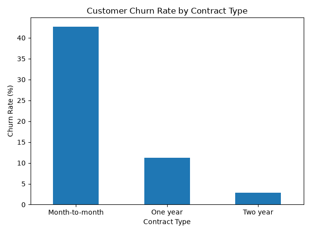
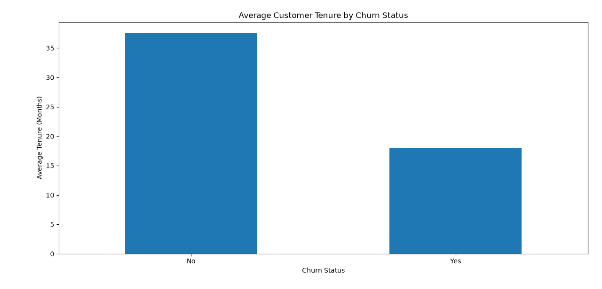
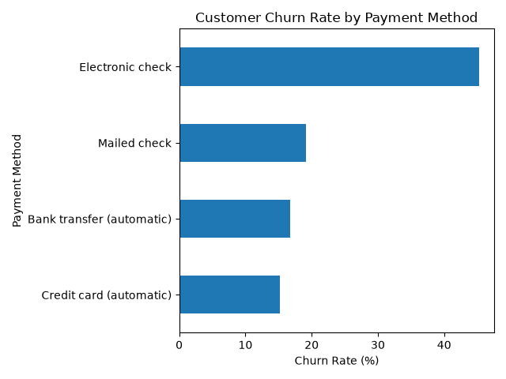
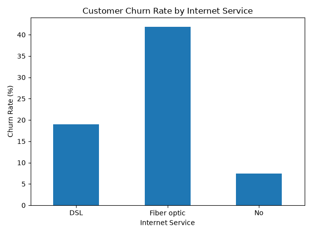
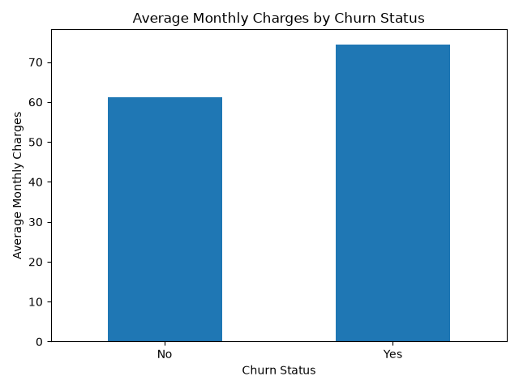
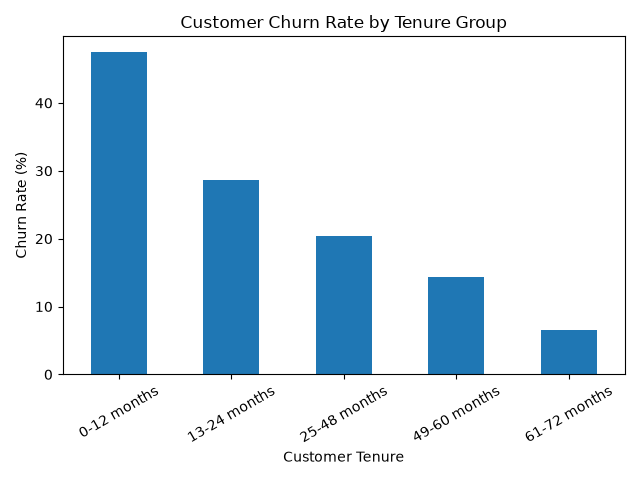
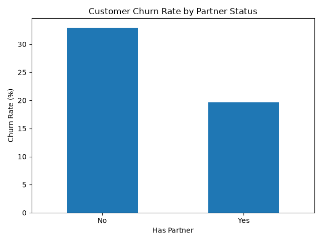

# FUTURE_DS_02: Customer Churn Analysis

## 📌 Project Overview
This project analyzes customer churn using Python, Pandas, and Matplotlib. The goal is to identify customer behavior patterns and understand which customer groups are more likely to leave a service.

## 🎯 Objectives
- Calculate the customer churn rate.
- Analyze churn across contract types.
- Compare customer tenure and monthly charges.
- Investigate churn by payment method and internet service.
- Identify patterns that can help improve customer retention.

## 🛠️ Tools and Technologies
- Python
- Pandas
- Matplotlib
- VS Code

## 📊 Key Findings
- Month-to-month customers show higher churn than customers with longer-term contracts.
- Customers using electronic check payments show higher churn.
- Customers with shorter tenure are more likely to leave.
- Customers who churn tend to have higher average monthly charges.
- Senior citizens have a higher churn rate than non-senior customers.
- Customers without a partner show higher churn than customers with a partner.

## 💡 Business Recommendations
- Encourage customers to choose long-term contracts.
- Investigate why electronic check users are more likely to leave.
- Offer onboarding support and incentives to new customers.
- Review pricing and service satisfaction among high-charge customers.
- Develop targeted retention strategies for higher-risk customer groups.

## 📁 Project Files
- `customer_churn_analysis.py` — Python analysis and visualizations.
- `README.md` — Project documentation.

## 📂 Dataset
IBM Telco Customer Churn dataset.

## 📈 Visualizations

### 1. Churn Rate by Contract Type

### 2. Average Customer Tenure by Churn

### 3. Churn by Payment Method

### 4. Churn by Internet Service

### 5. Monthly Charges by Churn

### 6. Churn by Tenure Group

### 7. Churn by Partner Status

## 👩‍💻 Internship
Future Interns — Data Science & Analytics Internship

**Project:** Customer Churn Analysis
